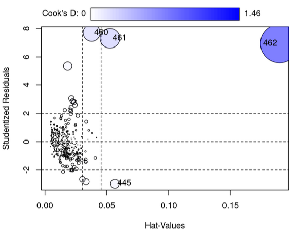
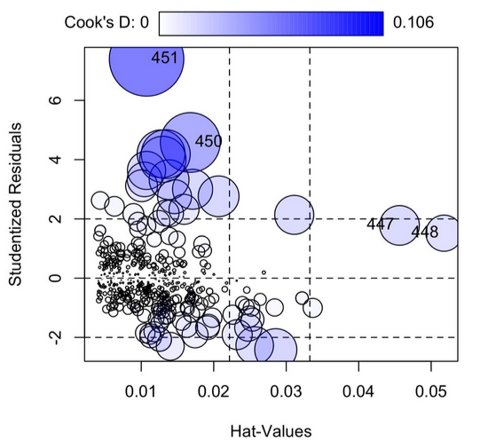
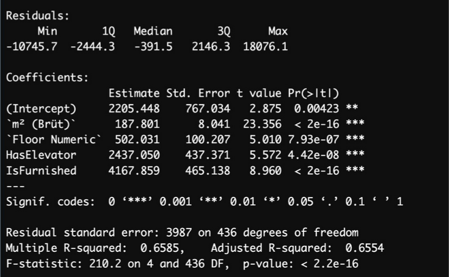
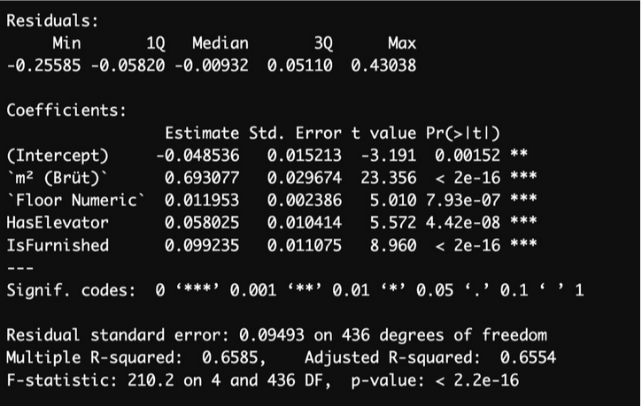

# Mecidiyeköy Rental Prices

I collected apartment rental listings in Mecidiyeköy, İstanbul from sahibinden.com and fit a multiple linear regression to see which listing features are related to the asking rent.

## Data

- 462 listings in `data.csv`, collected from sahibinden.com.
- `TRY Price` is the asking monthly rent in Turkish lira. Each listing also has a deposit field.
- Columns (Turkish, as on the site): listing ID, gross and net m², room count, building age, floor, total floors, heating, bathrooms, balcony, elevator, parking, furnished, inside a complex, dues (TL), deposit (TL). Some dues values are missing.

## How the data was collected

The listings were copied page by page and parsed with three small Python scripts:

- `key_combination.py`: a macOS hotkey macro (pynput). When I press Cmd+Alt+F9 on a listing page, it selects and copies the whole page, switches to a text file, pastes it at the end, switches back and closes the tab. This builds up `raw_data.txt`.
- `pruning.py`: reads `raw_data.txt` and keeps only the lines that start with the fields I need (plus the price line that follows "Emlak Kiralama Rehberi"). Writes `pruned_data.txt`.
- `convert_to_csv.py`: parses `pruned_data.txt` into one row per listing, cleans the numbers and writes `data.csv`.

The raw and pruned text files are not in the repo, and the input paths in the scripts are absolute paths on my machine.

## Analysis (`workbook.R`)

1. Compared the correlation of rent with gross and net m², and kept gross m².
2. Turned categories into numbers: room count to an ordinal rank, building age ranges to a number near the top of each range, floor labels (garden floor, basement, roof floor, etc.) to a floor number, yes/no fields to 0/1.
3. Dropped heating and bathroom count (too few observations in some levels), and the dues, deposit and complex columns.
4. Built the model step by step with VIF checks. Room rank was dropped because its coefficient came out negative next to m² (collinearity). Balcony was dropped for a high p-value.
5. Removed outliers with a z-score filter (|z| > 4) and then the 10 points with the highest Cook's distance. Parking dropped out after cleaning, and building age lost significance and was removed.
6. Min-max scaled rent and m² for the final model and computed the MSE.
7. Saved residual diagnostic plots and scatter plots of each predictor against rent.

## Results

The final model is `rent ~ m² + floor + elevator + furnished`, fit on 441 listings. In the unscaled version:

| Term | Estimate (TL) | p |
|---|---|---|
| Intercept | 2205 | 0.004 |
| m² (gross) | 188 per m² | < 2e-16 |
| Floor | 502 per floor | 7.9e-07 |
| Has elevator | 2437 | 4.4e-08 |
| Furnished | 4168 | < 2e-16 |

R² = 0.659 (adjusted 0.655), residual standard error about 3987 TL. Min-max scaling the variables does not change the fit, so R² is the same in the scaled model.

## Plots

Influence plot before removing outliers and influential points:

After:

Model summary (unscaled) and after min-max scaling:

## How to run

R packages: car, dplyr, readr, ggplot2, GGally. Run `workbook.R` from the repo folder; it reads `data.csv` and writes the diagnostic plots as JPEGs.

The collection scripts need Python 3 and `pynput` (only for `key_combination.py`, which uses macOS Cmd shortcuts).

## Limitations

- One neighborhood and one snapshot of listings. These are asking rents, not agreed rents.
- The listing date is not recorded.
- Some outliers were removed by rule and by Cook's distance, so the model describes typical listings, not the expensive end.
- No train/test split; R² and MSE are in-sample.
